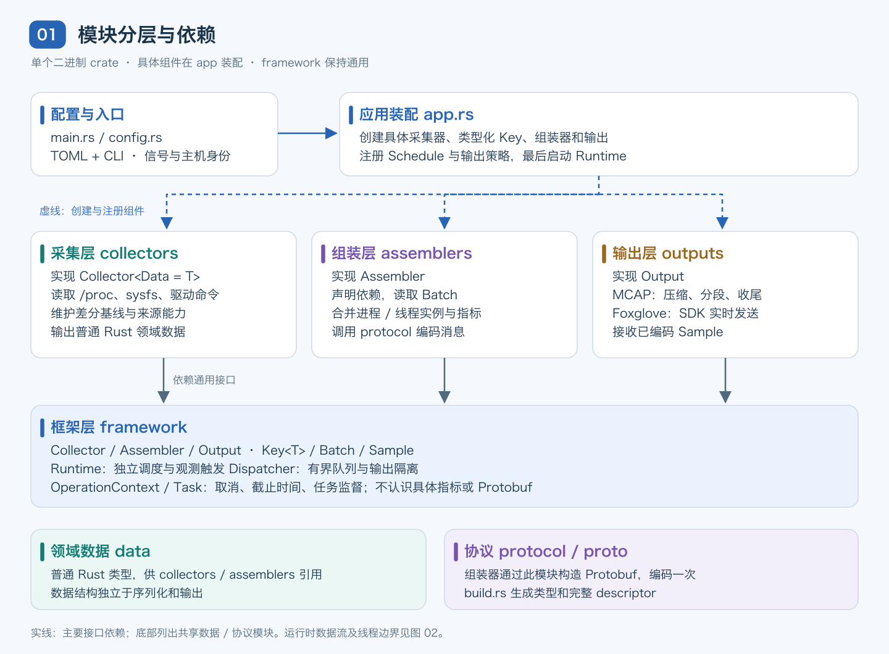
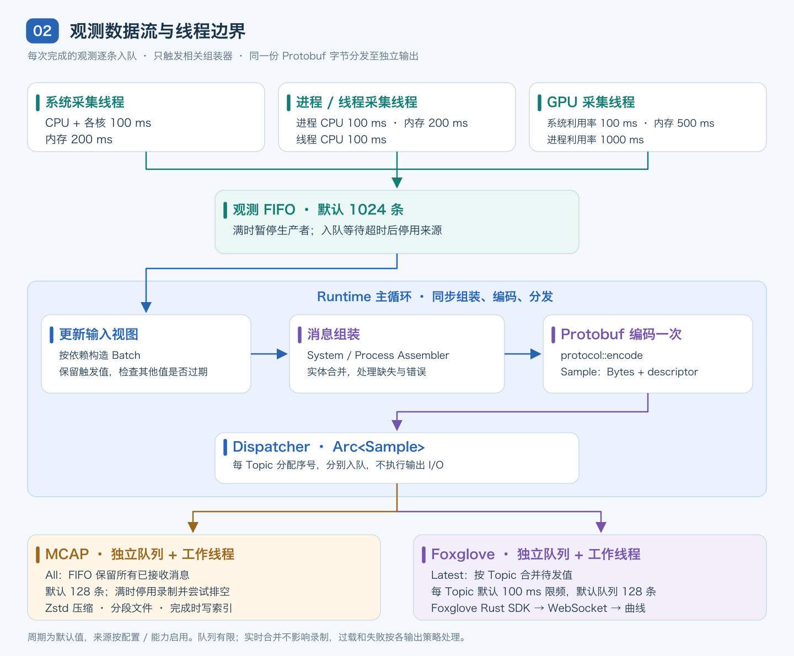
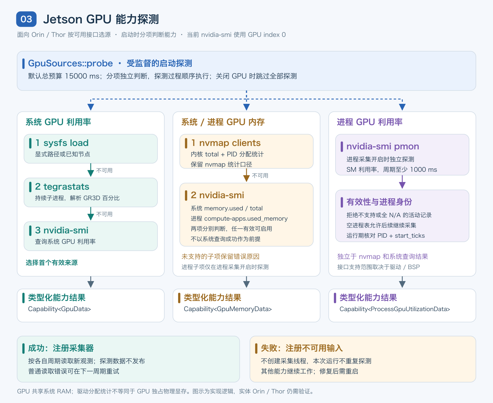
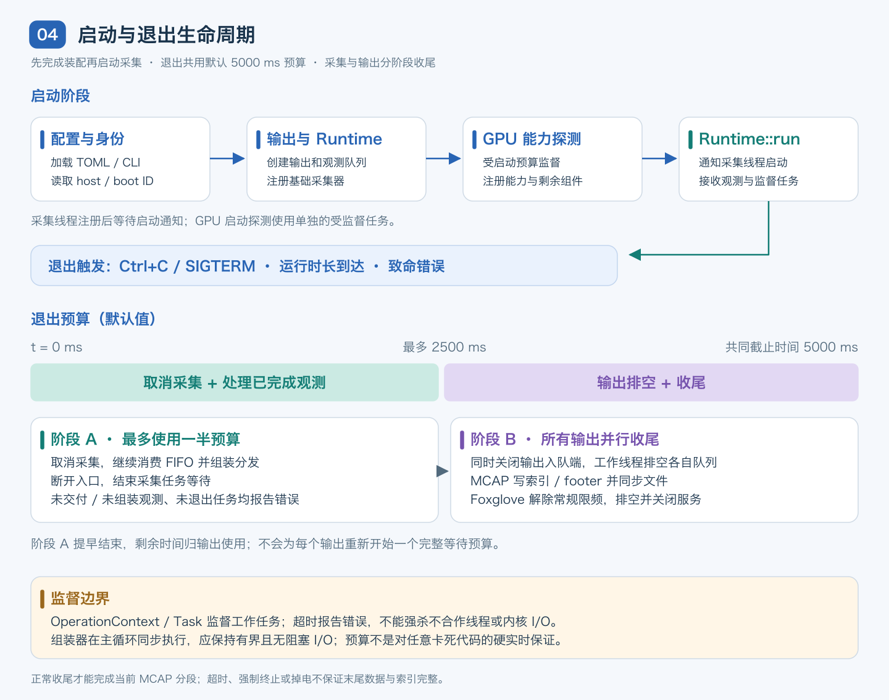

# Syslens 架构设计

本文描述当前代码的实现，覆盖采集、消息组装、持久化、实时发送和任务生命周期。Syslens 只面向 Linux，采用**一个 Cargo package、一个二进制 crate、按模块分层**的组织方式。

核心约定是：采集器输出普通 Rust 数据，一个或多个采集器的结果由组装器转换为 Protobuf 消息；框架负责调度和传递，不认识具体指标；MCAP 与 Foxglove 各自在独立模块中消费已编码消息。

## 1. 模块分层与依赖



[查看 SVG 原图](images/architecture-overview.svg)。图中的箭头表示主要的组件注册或接口依赖，运行时数据流见下一节。

| 模块 | 职责 | 依赖边界与代码入口 |
| --- | --- | --- |
| 应用装配层 | 加载配置、处理信号、创建组件、注册输入和组装器、启动 Runtime | [app.rs](../src/app.rs)、[config.rs](../src/config.rs)。这是知道所有具体组件的入口；GPU 来源选择留在采集模块。 |
| 通用框架层 | 类型化输入、独立调度、观测队列、依赖触发、输出分发、任务监督 | [framework](../src/framework/mod.rs)。不依赖具体采集器、领域数据、Protobuf 或输出实现。 |
| 领域数据层 | CPU、内存、进程、线程、GPU 等普通 Rust 数据结构 | [data](../src/data/mod.rs)。不包含序列化与传输逻辑。 |
| 采集层 | 读取系统接口，计算差分，维护基线与来源状态 | [collectors](../src/collectors/mod.rs)。实现 `Collector`，依赖领域数据和框架接口，不依赖组装器、协议或输出实现。 |
| 组装层 | 声明输入依赖、处理缺失与过期、合并实体、构造消息 | [assemblers](../src/assemblers/mod.rs)。实现 `Assembler`，读取 `Batch`，通过协议层编码；不调用采集器和输出。 |
| 协议层 | Protobuf 定义、生成类型、descriptor 与一次性编码 | [protocol](../src/protocol/mod.rs)、[proto](../proto)、[build.rs](../build.rs)。将具体消息转成框架的通用 `Sample`。 |
| 输出层 | MCAP 文件管理、Foxglove SDK 发布 | [mcap.rs](../src/outputs/mcap.rs)、[foxglove.rs](../src/outputs/foxglove.rs)。实现 `Output`，消费通用消息与 schema，不重新读取指标或编码 Protobuf。 |

分层通过 Rust 模块和接口实现，没有拆成多个 crate，也没有动态插件加载机制。新增指标通常修改领域数据、采集器、组装器、协议和装配配置，框架内部无需增加指标分支。

## 2. 运行时数据流与线程模型



[查看 SVG 原图](images/observation-flow.svg)。图中采集器按类别合并展示，实际是**每个采集器一个线程**；组装器和编码在 Runtime 主循环中同步执行，没有独立组装线程。

一次观测沿以下路径处理：

1. 采集线程按自己的周期调用 `collect`，记录开始时间、耗时、实际周期、来源序号和结果。一次普通读取失败也会产生带错误的观测。
2. 完成的观测进入共享的有界 FIFO。框架不会用新值覆盖尚未组装的旧观测。
3. Runtime 逐条取出观测，更新该输入的保留值，只触发声明依赖该输入的组装器。
4. Runtime 为组装器提供 `Batch`，其中只包含其声明的依赖。组装器组合本次观测与其他仍有效的输入，构造消息。
5. `protocol::encode` 用 Prost 编码一次，生成包含 `Bytes` 负载的 `Sample`。Dispatcher 分配 Topic 内消息序号，并以 `Arc<Sample>` 分发给各输出队列。
6. MCAP 工作线程按 FIFO 录制；Foxglove 工作线程按 Topic 合并待发值并限频，再交给 SDK。

Dispatcher 不执行文件或网络 I/O，也不等待队列腾出容量；入队只持有短暂的队列锁。两个输出各有队列和工作线程，因此慢磁盘不会直接阻塞实时发送，慢客户端也不会直接阻塞采集。

框架使用标准库线程、同步通道、互斥锁和条件变量；应用没有直接引入 Tokio 作为整体调度器，Foxglove SDK 管理自身运行环境。

### 2.1 核心接口

| 接口或类型 | 作用 |
| --- | --- |
| `Collector::Data` / `collect(&OperationContext)` | 关联类型明确采集结果；上下文提供取消与截止时间。 |
| `Key<T>` / `Dependency` | 输入名称与 Rust 类型身份绑定。注册时拒绝重名输入及依赖类型不匹配。 |
| `Assembler::dependencies()` / `assemble(&Batch)` | 声明依赖并返回 `Vec<Sample>`；同一输入可以驱动多个组装器。 |
| `Batch::read(key)` | 返回 `Result<Option<&T>>`。尚未就绪、读取失败或过期为 `None`；未声明依赖、类型错误为 `Err`，应传播错误。 |
| `Sample` / `StreamDescriptor` | 通用的 Topic、schema、编码类型、时间戳、序号和字节负载；框架不解析 Protobuf。 |
| `Output::write` / `Output::close` | 分别处理消息与收尾，均接收 `OperationContext`。 |
| `Task` / `Cancellation` | 统一监督采集、输出和 GPU 启动探测的取消、超时、退出及线程错误。 |

接口实现见 [runtime.rs](../src/framework/runtime.rs)、[snapshot.rs](../src/framework/snapshot.rs)、[sample.rs](../src/framework/sample.rs)、[dispatch.rs](../src/framework/dispatch.rs) 和 [control.rs](../src/framework/control.rs)。

### 2.2 有界队列与过载

观测入口默认容纳 1024 条记录。入口满时，生产者保留当前已完成观测并等待，不开始下一次采集。等待超过默认 1000 ms 后，框架报告未交付的来源序号并停用该采集任务。队列等待也可能导致错过后续调度时间点。

输出队列分别限额，默认各 128 条。队列容量按**条数**计算，不按字节数计算；包含大量进程和线程的单条消息仍可能很大。有限队列无法保证无限期无损，过载必须通过明确的停用或丢弃策略处理。

## 3. 采集来源、周期与时间语义

默认配置位于 [config/syslens.toml](../config/syslens.toml)。启动时从当前工作目录读取，`--config` 可覆盖路径；命令行参数优先于配置文件，未填写字段使用内置默认值。配置文件缺失或无效会使启动失败，修改后需重启。

| 输入名称 | 数据来源 | 默认周期 | 消息依赖 |
| --- | --- | ---: | --- |
| `cpu` | `/proc/stat`，一次读取产生总 CPU 与各逻辑核利用率 | 100 ms | SystemSample |
| `memory` | `/proc/meminfo`，系统内存与 swap | 200 ms | SystemSample |
| `process_cpu` | `/proc/PID/stat`，进程 CPU tick 差分 | 100 ms | ProcessSample |
| `process_memory` | `/proc/PID/stat` 与 `/proc/PID/cmdline`，RSS、虚拟内存与命令行 | 200 ms | ProcessSample |
| `thread_cpu` | `/proc/PID/task/TID/stat`，线程 CPU tick 差分 | 100 ms | ProcessSample |
| `gpu_utilization` | sysfs、tegrastats 或 nvidia-smi | 100 ms | SystemSample |
| `gpu_memory` | nvmap 或 nvidia-smi，系统及进程 GPU 内存 | 500 ms | SystemSample、ProcessSample |
| `process_gpu_utilization` | nvidia-smi pmon，驱动支持时可用 | 1000 ms | ProcessSample |

以上周期分别配置在 `[sampling]`。CPU 与内存的进程扫描相互独立，并未共享一份 `/proc` 扫描结果。进程筛选按 PID 或名称匹配；两者都为空时扫描全部可见进程。可独立关闭线程、进程或 GPU 采集。

调度使用单调时钟，错过时间点时跳过，不集中补采。CPU 利用率使用累计计数差分与实际观测间隔；首次观测、实体首次出现或计数器重置后没有有效基线时，利用率字段缺失。系统和单核 CPU 范围为 0–100%；进程占满一个逻辑核为 100%，多线程进程可超过 100%。

顶层 `interval_ms = 100` 控制 **Foxglove 每个 Topic 的发送间隔**，不控制采集、组装或录制频率。可选 `samples = N` 表示运行 `N × interval_ms` 毫秒后进入退出流程，计时从 Runtime 启动开始，不是发送 N 条消息。

### 3.1 触发时间与复用值

`header.timestamp` 和 `Sample.captured_at_ns` 使用触发观测的采集开始时间。MCAP 的 `log_time`、`publish_time` 和 Foxglove 消息时间戳均来自这个值，而不是磁盘写入或网络发送时间。

每个消息是多个来源的组合视图，不是所有指标同时读取的系统快照。`header.trigger_input` 表明这次更新由谁触发；`header.inputs` 保存各来源自己的时间和状态。并发采集按完成并入队的顺序处理，因此消息的采集时间戳不保证单调递增。

其他输入的有效期为其配置周期乘以 `stale_after_periods`，默认 3。距采集完成时长使用“触发观测完成时间减去该输入完成时间”的单调时钟差，负差按零处理；超过有效期时不参与组装。**触发观测本身始终保留**，不会因为等待组装或输出而被当作陈旧数据过滤。

例如，线程观测触发进程消息时，可以复用仍有效的进程内存；这并不代表内存又采集了一次。分析某个来源的原始时间序列时，应按 `trigger_input` 筛选或结合来源序号去重。

### 3.2 输入诊断

| `header.inputs` 字段 | 含义 |
| --- | --- |
| `timestamp` | 来源观测的采集开始时间；没有已完成采集时缺失。 |
| `interval_ms` / `actual_interval_ms` | 配置周期 / 最近两次采集开始的实际间隔。 |
| `collection_duration_ms` | 最近一次采集耗时。 |
| `age_ms` / `stale` | 距采集完成时长（以触发观测完成时刻为参照）/ 是否过期。 |
| `sample_sequence` | 来源采集尝试序号，复用输入保留原序号。 |
| `missed_periods` | 该采集线程累计跳过的调度时间点。 |
| `error` | 未就绪、不可用、读取失败、过期或任务停用原因。 |

`header.batch_id` 表示框架处理的观测批次；同一观测触发的两个消息可以有相同批次号。旧字段 `skipped_samples` 已 deprecated，当前恒为 0，不能用于判断输出端丢失。输出队列的丢弃和停用通过 stderr 诊断及退出汇总报告；实时合并次数目前仅在内部计数，未对外报告，也没有单独的健康状态 Topic。

## 4. 消息组装与实体身份

当前只发布两种消息。消息数量由观测触发决定，不是每个固定周期各发一条。

| 消息 / Topic | 组合内容 |
| --- | --- |
| `SystemSample` / `/syslens/system` | 系统 CPU、各核 CPU、系统内存、系统 GPU 利用率与 GPU 内存。依赖 `cpu`、`memory`，启用 GPU 时增加 `gpu_utilization`、`gpu_memory`。 |
| `ProcessSample` / `/syslens/processes` | 进程 CPU、RSS、虚拟内存、命令行、线程 CPU、进程 GPU 利用率与 GPU 内存。依赖进程 CPU/内存，并按配置增加线程、GPU 内存和进程 GPU 利用率输入。 |

关闭进程采集后只发布系统消息。旧 `GpuSample` 仅保留 deprecated schema，不再发布。

进程组装器按各有效来源的 **`(PID, start_ticks)` 并集**建立进程列表，再合并匹配指标。进程 CPU 来源不是其他指标的前置条件；即使 CPU 不可用，内存、线程或 GPU 来源仍可形成进程记录。同一个 PID 对应不同启动 tick 时，是两个不同实例，不会把旧进程的 GPU 数据合并给新进程。

`instance_id` 包含系统 boot ID、PID 和启动 tick；线程身份进一步包含 TID 与线程启动 tick。GPU 查询前后还会核对进程启动 tick，拒绝查询期间退出或被复用的 PID。各来源异步更新时，旧实例可能在其输入过期前短暂保留。

消息通过 optional 字段和错误信息表达缺失：没有基线、来源不可用、身份不匹配等情况不填虚构的 0。GPU 内存独立于系统 RAM 和进程 RSS；Jetson 共享物理 RAM，nvmap 分配统计也不等同于 GPU 独占物理显存。`memory_scope`、来源和独立时间戳保留统计口径。

协议按职责拆分：

| 文件 | 内容 |
| --- | --- |
| [common.proto](../proto/common.proto) | Header、InputStatus、GpuMetrics。 |
| [system.proto](../proto/system.proto) | SystemSample、Cpu、CpuCore、Memory，以及旧 GpuSample。 |
| [process.proto](../proto/process.proto) | ProcessSample、Process、Thread。 |

三个文件共用 `syslens.v1` package，生成的 Rust 类型位于 `protocol::pb`。构建脚本生成包含 Timestamp 依赖的完整 descriptor；MCAP 每个分段和 Foxglove channel 都携带 schema。新增字段应保留已有编号和 wire type；删除字段时保留编号与名称，避免重用。

## 5. Jetson GPU 能力探测



[查看 SVG 原图](images/gpu-capabilities.svg)。三个分支表示独立的能力判断，不表示启动时并行执行探测。

GPU 来源选择封装在 [gpu_sources.rs](../src/collectors/gpu_sources.rs) 和 [gpu_accounting.rs](../src/collectors/gpu_accounting.rs)，应用只接收三类带类型的能力结果：系统利用率、GPU 内存、进程利用率。

- **系统利用率**：尝试显式或已知 sysfs load 节点，失败后尝试持续运行的 tegrastats，再以 nvidia-smi 系统利用率查询补充。选择首个有效来源。
- **GPU 内存**：优先 nvmap；不可用时分别探测 nvidia-smi 的系统内存和计算进程内存查询。任一有效即可保留该内存采集能力，另一项保留不可用原因。
- **进程利用率**：启用进程采集时独立探测 nvidia-smi pmon。系统查询失败或 nvmap 成功，都不阻止这一项能力判断。

能力探测只在启动时执行一次。成功时注册对应采集器；失败时通过 `add_capability` 注册带类型的不可用输入，不创建定期重探测任务。没有 Jetson 或相关权限不足时，CPU、内存与进程监控仍可继续；GPU 缺失及原因进入消息状态。修复来源后需重启。显式关闭 GPU 则跳过探测，消息不包含 GPU 指标。

探测结果不作为监控观测发布，正式运行会读取新数据。已启动的 tegrastats 子进程会继续使用，并按配置周期输出。nvidia-smi 当前查询 GPU index 0；pmon 的配置周期至少为 1000 ms。占位设备和没有有效数值的接口会被拒绝，空进程表本身不算能力失败。

启动探测有默认 15000 ms 总预算，单次 GPU 命令或读取默认超时 1500 ms。子进程封装见 [command.rs](../src/collectors/command.rs)：非阻塞读取、取消检查、有界缓冲区，并只清理本程序创建的子进程组。

运行期的普通读取错误产生错误观测，下一周期仍可重试；框架检测到任务超时、panic 或入队超时则停用整个采集任务。读取重试与启动来源重探测是两种不同的行为。

## 6. 持久化与实时发送

| 行为 | MCAP | Foxglove |
| --- | --- | --- |
| 实现 | `outputs::mcap`，mcap crate | `outputs::foxglove`，Foxglove Rust SDK |
| 队列模式 | `Delivery::All`，按接收顺序保存 | `Delivery::Latest`，同 Topic 只保留最新待发值 |
| 默认队列容量 | 128 条 | 128 条 |
| 默认满队列策略 | `disable`：停止接收后续消息，尝试排空已接收数据 | `drop_oldest`：丢弃最旧待发消息；正常情况下还会按 Topic 合并 |
| 默认失败策略 | `isolate`，其余输出继续 | `isolate`，其余输出继续 |
| 单次操作超时 | 5000 ms | 5000 ms |
| 结果位置 | `recordings/` 中的分段文件 | 默认 `127.0.0.1:8765` WebSocket 服务 |

两个输出消费同一份已编码字节，但实时端会合并更新，因此不保证收到与 MCAP 相同的消息条数。Foxglove SDK 还维护自身的客户端积压队列，当前大小为 128，与上述应用输出队列是不同层次。

输出均支持 `overflow = disable / drop_newest / drop_oldest` 和 `on_failure = isolate / stop`。选择 `stop` 时，该输出失败将结束整个运行；默认隔离允许其他输出继续，但发生输出故障的运行最终仍返回错误。所有输出失效时结束运行。

MCAP 默认使用 Zstd 压缩和 1 MiB chunk。每 300 秒或累计 64 MiB 未压缩消息负载后，在下一次写入前轮转；阈值不是精确文件大小，单条消息可能使其超出阈值。默认 `flush_ms = 1000` 在写入时检查并 flush chunk，不是独立的定时落盘线程，也不表示每秒执行 `fsync`。正常分段结束或退出时写索引和 footer，再刷新文件缓冲区并执行 `sync_all`。

## 7. 启动、退出与失败边界



[查看 SVG 原图](images/shutdown-lifecycle.svg)。退出阶段共用一个截止时间，不是给每个线程各等待 5 秒。

启动顺序为：读取配置与主机身份，创建输出与 Runtime，注册基础采集器，完成 GPU 能力探测，注册剩余输入和组装器，最后调用 `Runtime::run`。采集任务在注册时创建线程，但等待启动通知；完成装配前不会提前采集。GPU 探测失败可以形成不可用能力，探测任务超过总预算则启动失败。

Ctrl+C、SIGTERM、运行时长到达或致命错误会进入退出流程。默认退出预算为 5000 ms：

1. 立即发出采集取消信号，继续消费已完成观测，组装并分发。此阶段最多使用前一半预算，即 2500 ms。
2. 断开观测入口，结束采集任务的等待；尚未组装的数据或未退出的任务会报告错误。
3. 同时关闭所有输出的入队端，让输出工作线程并行排空并收尾。Foxglove 排空时不再受常规限频约束，MCAP 完成分段。
4. 在共同截止时间前等待工作线程退出，汇总失败。采集阶段提早完成时，剩余时间都可供输出使用。

`OperationContext` 约定操作主动检查取消和截止时间；`Task` 负责监督执行状态、panic 与超时。Rust 无法强制结束不合作的线程或卡在内核中的 I/O，超时后会记录错误并分离线程句柄，不能据此声称数据完整落盘。

组装器同步执行在主循环中，目前没有独立任务超时机制。因此组装器应只做有界的数据组合和编码，不应引入阻塞 I/O；任意卡死的组装器会阻塞主循环，退出预算不构成对这种实现错误的硬实时保证。GPU 启动探测受任务监督，普通配置读取和输出构造也不等同于都受同一个启动超时保护。

| 情况 | 当前处理 |
| --- | --- |
| 启动时可选 GPU 接口不可用 | 注册不可用输入，本次运行不重探测，其他来源继续。 |
| 普通采集读取失败 | 发布错误状态，不继续使用该来源旧成功值；后续周期可重试。 |
| 采集任务超时、panic、入队超时 | 停用该任务并报告；所有采集任务均失效时结束运行。 |
| 输出过载或写入失败 | 按该输出的 overflow / on_failure 配置处理。 |
| 类型接线错误、组装失败、同 Topic schema 冲突 | 返回错误并进入退出流程。 |
| 强制终止、掉电、I/O 超时 | 当前分段可能不完整，无法保证最后数据与索引持久化。 |

## 8. 扩展方式与验证

新增采集数据时，在 `data` 定义 Rust 数据，在 `collectors` 实现 `Collector`，在配置中增加周期，由 `app` 创建 `Key<T>` 并注册。随后让现有组装器声明新依赖，或增加新的组装器，按需扩展 Protobuf。通过 `batch.read(key)?` 区分正常缺失与接线错误；对可选来源使用带类型的不可用注册。已有输出通常无需修改。

新增输出时实现 `Output`，在装配层注册并明确队列容量、交付模式、过载和失败策略。不要让输出回调采集器，也不要在框架中增加某种协议或存储格式的特例。

目前测试覆盖观测逐条保留、依赖校验、保留输入过期、实时合并、失败隔离、退出、进程身份合并、GPU 分项探测和子进程取消；Linux 集成测试验证真实进程/线程进入 MCAP，以及真实 WebSocket 订阅后的 Protobuf 与时间戳。入口见 [framework tests](../src/framework/tests.rs)、[app tests](../src/app.rs) 和各实现模块的测试。

在 Linux 上执行 `cargo fmt --all -- --check`、`cargo clippy --locked --all-targets -- -D warnings` 和 `cargo test --locked`。GPU 测试使用接口样本和模拟命令，实体 Orin/Thor 尚需验证驱动接口、权限、统计口径和高频采集开销；100 ms 配置不代表底层驱动一定提供同等时间分辨率。

## 9. 配图维护

本文四张图均为绘制的矢量图，同时提供 PNG 预览，不依赖文本 art 或 Mermaid 渲染。图源集中在 [render_diagrams.py](diagrams/render_diagrams.py)，生成文件位于 [images](images)。

使用 Python 3 和 `rsvg-convert`（librsvg）重新生成：

```sh
python3 docs/diagrams/render_diagrams.py
```

脚本只使用 Python 标准库，并调用 `rsvg-convert` 输出 PNG；需安装可显示中文的字体，例如 Noto Sans CJK SC 或 Hiragino Sans GB。修改架构后同步更新正文、图源及生成的 SVG/PNG，并检查文字、箭头与相对链接。
